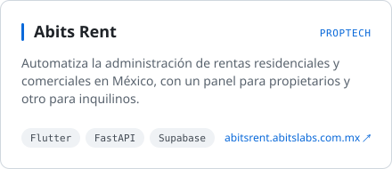
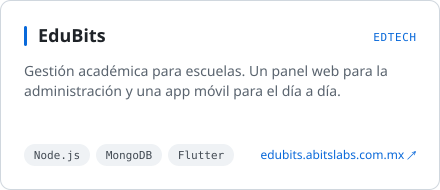
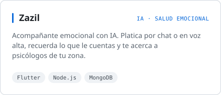
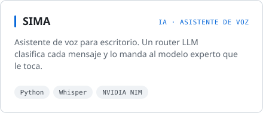

<picture><source media="(prefers-color-scheme: dark)" srcset="https://readme-typing-svg.demolab.com?font=Fira+Code&weight=500&size=24&pause=1200&center=true&vCenter=true&width=520&height=44&lines=Hola%2C+soy+Sebasti%C3%A1n;Desarrollador+Full-Stack;Web+%2B+M%C3%B3vil&color=E6EDF3"></picture>

**CEO de [Abits Labs](https://abitslabs.com.mx)**

[abitslabs.com.mx](https://abitslabs.com.mx) · [sebastian@abitslabs.com.mx](mailto:sebastian@abitslabs.com.mx) · [github.com/Abits-Labs](https://github.com/Abits-Labs)

 

Dirijo Abits Labs, una startup mexicana de software. Hacemos Abits Rent, para administrar rentas, y EduBits, para escuelas. Sigo metido en el código: hago la app, la API y también administro el servidor donde corre todo.

Por fuera de Abits hago Zazil, una acompañante emocional con IA, y SIMA, mi asistente de voz.

 

### En qué trabajo

<a href="https://abitsrent.abitslabs.com.mx"><picture><source media="(prefers-color-scheme: dark)" srcset="assets/abits-rent-dark.svg"></picture></a>
<a href="https://edubits.abitslabs.com.mx"><picture><source media="(prefers-color-scheme: dark)" srcset="assets/edubits-dark.svg"></picture></a>

<picture><source media="(prefers-color-scheme: dark)" srcset="assets/zazil-dark.svg"></picture>
<picture><source media="(prefers-color-scheme: dark)" srcset="assets/sima-dark.svg"></picture>

El código de estos proyectos vive en repositorios privados.

 

### Stack

| | |
|:--|:--|
| **Web** |       |
| **Móvil** |     |
| **Backend** |        |
| **Infraestructura** |     |

 

### GitHub

<picture><source media="(prefers-color-scheme: dark)" srcset="https://github-readme-stats.vercel.app/api?username=KlGamers&show_icons=true&count_private=true&hide_rank=true&card_width=440&border_radius=10&locale=es&custom_title=Actividad+en+GitHub&bg_color=00000000&title_color=E6EDF3&text_color=9198A1&icon_color=58A6FF&border_color=30363D"></picture>
<picture><source media="(prefers-color-scheme: dark)" srcset="assets/langs-dark.svg"></picture>

<picture><source media="(prefers-color-scheme: dark)" srcset="https://streak-stats.demolab.com?user=KlGamers&locale=es&border_radius=10&background=00000000&border=30363D&stroke=30363D&ring=58A6FF&fire=58A6FF&currStreakNum=E6EDF3&sideNums=E6EDF3&currStreakLabel=58A6FF&sideLabels=9198A1&dates=9198A1"></picture>

<picture><source media="(prefers-color-scheme: dark)" srcset="https://raw.githubusercontent.com/KlGamers/KlGamers/output/github-contribution-grid-snake-dark.svg"></picture>

