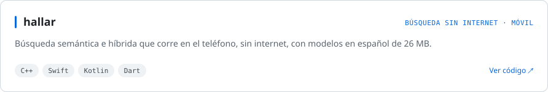
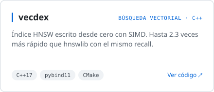
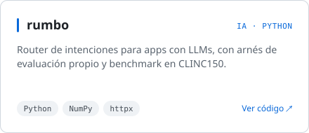
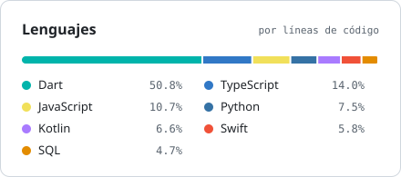

<picture><source media="(prefers-color-scheme: dark)" srcset="https://readme-typing-svg.demolab.com?font=Fira+Code&weight=500&size=24&pause=1200&center=true&vCenter=true&width=520&height=44&lines=Hola%2C+soy+Sebasti%C3%A1n;Desarrollador+Full-Stack;Web+%2B+M%C3%B3vil&color=E6EDF3"></picture>

**Fundador y CEO de [Abits Labs](https://abitslabs.com.mx)**

[abitslabs.com.mx](https://abitslabs.com.mx) · [sebastian@abitslabs.com.mx](mailto:sebastian@abitslabs.com.mx)

 

Tengo 19 años, estudio Ingeniería en Sistemas en el Tec de Durango (ITD) y soy el fundador y CEO de Abits Labs. En mi día a día dirijo el desarrollo de nuestros productos de software, como Abits Rent y EduBits, involucrándome directamente en todo el stack tecnológico. Me gusta participar en cada etapa del proceso: desde diseñar la arquitectura y construir las aplicaciones móviles y web, hasta levantar las APIs, configurar las bases de datos y administrar nuestros despliegues en la nube. Básicamente, si un proyecto necesita código o infraestructura, yo me encargo de armarlo.

<b>Más sobre mí</b>

 

Fuera de la startup, me considero un desarrollador al que le gusta construir herramientas para resolver problemas propios y experimentar con nuevas tecnologías. Disfruto mucho integrar modelos de inteligencia artificial en proyectos paralelos, como mi asistente de voz SIMA o el acompañante emocional Zazil. Incluso llegué a programar mi propio navegador móvil personalizado simplemente porque quería una plataforma más rápida y cómoda para leer novelas ligeras y manga en mi tiempo libre.

Cuando no estoy frente a un monitor, busco desconectarme y mantener un buen equilibrio. Entre mis apuntes de ingeniería en la universidad y el trabajo, me organizo para administrar un negocio de reventa en el campus junto con mi hermano y disfrutar del tiempo con mi novia. Soy un gran entusiasta de los autos deportivos y la Fórmula 1. A mediano y largo plazo, mi enfoque no solo está en escalar el software de mi empresa, sino también en diversificarme hacia las inversiones en bienes raíces y cumplir mi objetivo de viajar por el mundo a lugares como Japón, Suiza o Dubai, idealmente haciendo coincidir el viaje con un Gran Premio de F1. Siempre estoy abierto a conectar para platicar sobre startups, código, inversiones o la próxima carrera.

 

### Proyectos destacados

<a href="https://github.com/KlGamers/hallar"><picture><source media="(prefers-color-scheme: dark)" srcset="assets/hallar-dark.svg"></picture></a>

<a href="https://github.com/KlGamers/vecdex"><picture><source media="(prefers-color-scheme: dark)" srcset="assets/vecdex-dark.svg"></picture></a>
<a href="https://github.com/KlGamers/rumbo"><picture><source media="(prefers-color-scheme: dark)" srcset="assets/rumbo-dark.svg"></picture></a>

 

### Stack

<table>
<tr>
<td valign="top" width="25%">

**Web**

</td>
<td valign="top" width="25%">

**Móvil**

</td>
<td valign="top" width="25%">

**Backend, infra y herramientas**

</td>
<td valign="top" width="25%">

**Blockchain**

</td>
</tr>
</table>

 

### GitHub

<picture><source media="(prefers-color-scheme: dark)" srcset="https://github-readme-stats.vercel.app/api?username=KlGamers&show_icons=true&count_private=true&hide_rank=true&card_width=440&border_radius=10&locale=es&custom_title=Actividad+en+GitHub&bg_color=00000000&title_color=E6EDF3&text_color=9198A1&icon_color=58A6FF&border_color=30363D"></picture>
<picture><source media="(prefers-color-scheme: dark)" srcset="assets/langs-dark.svg"></picture>

<picture><source media="(prefers-color-scheme: dark)" srcset="https://streak-stats.demolab.com?user=KlGamers&locale=es&border_radius=10&background=00000000&border=30363D&stroke=30363D&ring=58A6FF&fire=58A6FF&currStreakNum=E6EDF3&sideNums=E6EDF3&currStreakLabel=58A6FF&sideLabels=9198A1&dates=9198A1"></picture>

<picture><source media="(prefers-color-scheme: dark)" srcset="https://raw.githubusercontent.com/KlGamers/KlGamers/output/github-contribution-grid-snake-dark.svg"></picture>

